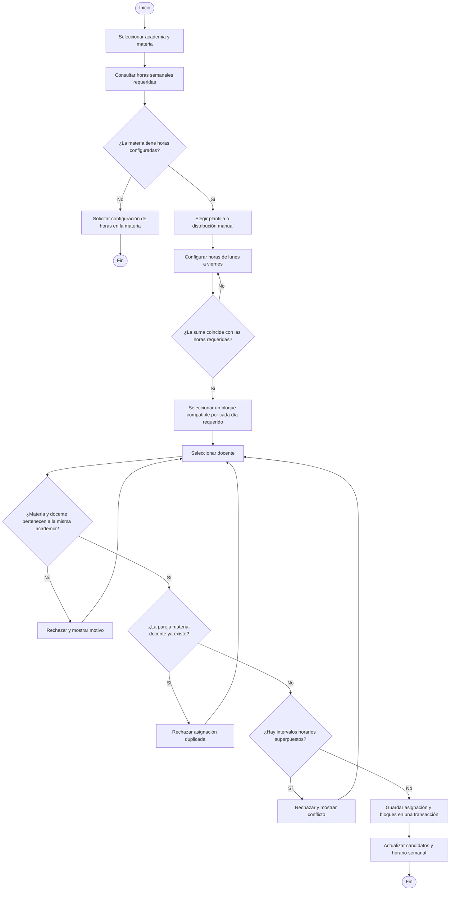
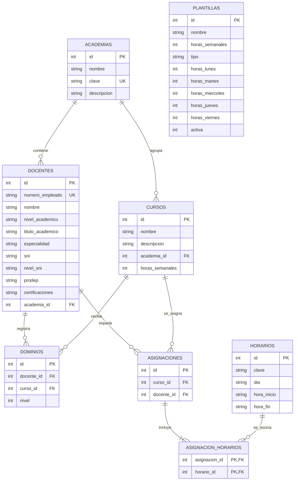

# Levantamiento de Requerimientos de Software

## Sistema de Gestión de Información Académica de Docentes

---

## 1. Propósito del documento

Este documento establece el alcance, los requerimientos funcionales y no funcionales, las reglas de negocio, el modelo de datos lógico y los criterios de aceptación de la versión actual del Sistema de Gestión de Información Académica de Docentes.

Su propósito es servir como referencia para el desarrollo, la verificación, el mantenimiento y la presentación del prototipo. Describe las funciones contempladas en la implementación actual y distingue expresamente las capacidades disponibles de aquellas que se reservan para versiones futuras.

## 2. Descripción general

El sistema es una aplicación web local destinada a administrar información académica y profesional de docentes, academias y materias. Permite registrar el nivel de dominio de un docente sobre una materia y realizar asignaciones manuales de docentes, cada una con una distribución semanal y bloques horarios concretos.

La aplicación proporciona información para apoyar la decisión del administrador. Permite consultar docentes de la misma academia que una materia y ordenar a los candidatos según el nivel de dominio registrado. **No ejecuta un algoritmo integral de elegibilidad basado en competencias, requisitos académicos o certificaciones vigentes, ni asigna docentes de manera automática.** La selección final corresponde al administrador.

La solución comprende los módulos de academias, docentes, materias, dominios, plantillas, horarios y asignaciones. También consulta catálogos académicos de apoyo. La información operativa se persiste en una base de datos SQLite local.

Una distinción central del modelo es que **la materia define la cantidad de horas semanales requeridas, mientras que cada asignación define cómo y en qué horarios concretos se impartirá esa materia a través de un docente**. Por ello, la plantilla y la distribución diaria no pertenecen al registro general de la materia.

## 3. Alcance del prototipo

### 3.1 Funciones incluidas

- Registrar, consultar, actualizar y eliminar academias, de acuerdo con las restricciones de integridad.
- Registrar, consultar, actualizar y eliminar docentes, de acuerdo con las restricciones de integridad.
- Registrar, consultar, actualizar y eliminar materias, incluyendo la cantidad de horas semanales requeridas.
- Registrar, consultar, actualizar y eliminar el nivel de dominio de un docente sobre una materia.
- Consultar los catálogos académicos utilizados por los formularios: licenciaturas, maestrías, doctorados, niveles SNI y especialidades.
- Consultar los bloques horarios predefinidos disponibles.
- Consultar plantillas de distribución semanal según la cantidad de horas requerida.
- Utilizar una plantilla como punto de partida para configurar la distribución de una asignación.
- Modificar manualmente la distribución propuesta por una plantilla sin alterar la plantilla original.
- Crear, duplicar y actualizar plantillas personalizadas, de acuerdo con las restricciones del módulo de plantillas.
- Crear y consultar asignaciones manuales entre materias y docentes.
- Asociar a cada asignación uno o varios bloques horarios, con una sesión como máximo por día.
- Validar que la duración de los bloques seleccionados corresponda a la distribución semanal y que su suma coincida con las horas requeridas por la materia.
- Validar que el docente no tenga otra asignación cuyo intervalo horario se superponga con alguno de los bloques propuestos.
- Eliminar asignaciones y liberar los vínculos con sus bloques horarios.
- Validar en el servidor las reglas principales de integridad antes de guardar cambios.
- Persistir la información operativa en una base de datos SQLite local.

### 3.2 Funciones fuera del alcance de esta versión

Las siguientes funciones pertenecen al diseño conceptual o a posibles ampliaciones. No deben presentarse como implementadas en el prototipo actual:

- Autenticación, cuentas de usuario, sesiones, roles y permisos.
- Evaluación automática e integral de elegibilidad mediante competencias, requisitos obligatorios o recomendados y certificaciones vigentes.
- Administración normalizada de competencias y requisitos de los cursos.
- Gestión completa de múltiples grados académicos y certificaciones por docente, con fechas de emisión, vencimiento y vigencia.
- Pertenencia de un docente a varias academias.
- Asociación de una materia con varias academias.
- Gestión explícita de grupos o secciones de una misma materia.
- Permitir que un mismo docente tenga varias asignaciones independientes de la misma materia para representar grupos distintos.
- Secuencias académicas y relaciones de precedencia entre materias.
- Gestión de proyectos académicos y de docentes responsables o participantes.
- Registro de aulas, laboratorios, recursos y equipamiento.
- Reservación de espacios físicos.
- Gestión de estudiantes, periodos escolares, nómina o recursos humanos.
- Notificaciones, reportes estadísticos avanzados e integración con sistemas externos.
- Auditoría histórica de cambios y desactivación lógica generalizada de registros.

## 4. Usuarios y entorno operativo

### 4.1 Usuario previsto

| Usuario | Funciones | Estado |
|---|---|---|
| Administrador operativo | Gestionar academias, docentes, materias, dominios, plantillas y asignaciones | Perfil previsto para el prototipo; no se implementa inicio de sesión |

El sistema no verifica la identidad de quien lo utiliza ni aplica permisos por perfil. La ausencia de autenticación limita su uso previsto a un entorno académico local o controlado. No debe interpretarse como una solución preparada para exponerse directamente a una red pública.

### 4.2 Entorno técnico

| Componente | Tecnología |
|---|---|
| Interfaz | HTML, CSS, JavaScript y W3.CSS |
| Servidor | Node.js y Express |
| Acceso a datos | `better-sqlite3` mediante un DAO y modelos separados |
| Base de datos | SQLite, archivo `db/app.db` |
| Comunicación | Solicitudes HTTP desde la interfaz hacia una API local |
| API habitual | `http://localhost:3000` |
| Ejecución de la interfaz | Archivos HTML servidos por separado durante el desarrollo |

## 5. Requerimientos funcionales

Los siguientes requerimientos describen el comportamiento previsto de la versión actual. La prioridad indica su importancia dentro del prototipo, no una garantía de disponibilidad fuera de su alcance.

### 5.1 Gestión de academias

#### RF-ACA-01 — Consultar academias

El sistema deberá permitir consultar las academias registradas y sus datos principales.

**Prioridad:** Alta.  
**Criterio de aceptación:** la consulta devuelve los registros existentes sin modificar la base de datos.

#### RF-ACA-02 — Registrar academia

El sistema deberá permitir registrar una academia con nombre, clave y descripción.

**Prioridad:** Alta.  
**Criterios de aceptación:**

- El nombre y la clave son obligatorios.
- La clave contiene únicamente letras ASCII sin acentos y números; no admite espacios y tiene entre 1 y 10 caracteres.
- La clave no puede duplicarse, sin distinguir entre mayúsculas y minúsculas.
- Una solicitud inválida se rechaza con un mensaje comprensible.

#### RF-ACA-03 — Actualizar academia

El sistema deberá permitir modificar los datos de una academia existente y conservar su identificador.

**Prioridad:** Alta.  
**Criterio de aceptación:** el sistema rechaza una clave duplicada y no modifica la academia si la validación falla.

#### RF-ACA-04 — Eliminar academia

El sistema deberá permitir eliminar una academia únicamente cuando no tenga docentes ni materias asociados.

**Prioridad:** Media.  
**Criterio de aceptación:** si existen dependencias, la operación se rechaza y se informa el motivo.

### 5.2 Gestión de docentes

#### RF-DOC-01 — Consultar docentes

El sistema deberá mostrar los docentes registrados y sus principales datos académicos y administrativos.

**Prioridad:** Alta.

#### RF-DOC-02 — Registrar docente

El sistema deberá permitir registrar un docente mediante número de empleado, nombre, nivel académico, título obtenido, especialidad, información SNI, perfil PRODEP, certificaciones y academia.

**Prioridad:** Alta.  
**Criterios de aceptación:**

- El número de empleado, el nombre, el nivel académico, el título académico y la academia son obligatorios.
- El número de empleado no se puede duplicar.
- El nivel académico debe corresponder a una opción reconocida por el sistema.
- Si el docente pertenece al SNI, debe especificarse su nivel.
- La academia indicada debe existir.

#### RF-DOC-03 — Actualizar docente

El sistema deberá permitir modificar la información de un docente existente.

**Prioridad:** Alta.  
**Criterios de aceptación:** se conservan las reglas de validación del registro y no se permite duplicar el número de empleado. Tampoco se permite cambiar la academia cuando el docente tiene relaciones que impiden ese cambio.

#### RF-DOC-04 — Eliminar docente

El sistema deberá permitir eliminar un docente cuando no existan dominios o asignaciones que dependan de él.

**Prioridad:** Media.  
**Criterio de aceptación:** si existen relaciones dependientes, la eliminación se rechaza y la información permanece intacta.

### 5.3 Gestión de materias

#### RF-MAT-01 — Consultar materias

El sistema deberá mostrar las materias registradas, su descripción, la academia a la que pertenecen y las horas semanales requeridas.

**Prioridad:** Alta.  
**Criterio de aceptación:** la consulta presenta la información de cada materia. Los registros heredados que todavía no tengan horas configuradas se identifican como pendientes.

#### RF-MAT-02 — Registrar materia

El sistema deberá permitir registrar una materia mediante nombre, descripción, academia y cantidad de horas semanales requeridas.

**Prioridad:** Alta.  
**Criterios de aceptación:**

- El nombre, la academia y las horas semanales son obligatorios.
- La academia debe existir.
- Las horas semanales deben ser un número entero entre 1 y 10.
- No se permite repetir el mismo nombre dentro de una misma academia.
- El formulario de materia no administra plantillas ni distribuciones por día.

#### RF-MAT-03 — Actualizar materia

El sistema deberá permitir modificar el nombre, la descripción, la academia y las horas semanales de una materia existente.

**Prioridad:** Alta.  
**Criterios de aceptación:**

- Se validan nuevamente los campos obligatorios, la academia y la unicidad del nombre dentro de la academia.
- Las horas semanales deben ser un entero entre 1 y 10.
- Si la materia tiene asignaciones, el cambio de horas semanales solo se permite cuando **cada asignación existente** continúa teniendo una duración semanal total exactamente igual al nuevo requisito.
- Si una o más asignaciones no cumplen el nuevo requisito, el cambio se rechaza y se solicita ajustar primero sus horarios.
- No se permite cambiar la academia cuando existen dominios o asignaciones asociados que impiden la operación.

#### RF-MAT-04 — Eliminar materia

El sistema deberá permitir eliminar una materia cuando no existan dominios o asignaciones que dependan de ella.

**Prioridad:** Media.  
**Criterio de aceptación:** si hay relaciones dependientes, la eliminación se rechaza.

### 5.4 Gestión de dominios

#### RF-DOM-01 — Consultar dominios

El sistema deberá mostrar los niveles de dominio registrados entre docentes y materias.

**Prioridad:** Alta.

#### RF-DOM-02 — Registrar dominio

El sistema deberá permitir registrar el nivel de dominio de un docente sobre una materia.

**Prioridad:** Alta.  
**Criterios de aceptación:**

- El nivel es un número entero de 1 a 10.
- El docente y la materia deben existir.
- El docente y la materia deben pertenecer a la misma academia.
- Solo puede existir un registro para cada pareja docente-materia.

#### RF-DOM-03 — Actualizar dominio

El sistema deberá permitir cambiar el docente, la materia o el nivel de un registro de dominio, respetando las reglas de integridad y evitando duplicar la pareja docente-materia.

**Prioridad:** Media.

#### RF-DOM-04 — Eliminar dominio

El sistema deberá permitir eliminar un registro de dominio existente.

**Prioridad:** Media.

### 5.5 Gestión de plantillas de distribución

#### RF-PLA-01 — Consultar plantillas

El sistema deberá permitir consultar las plantillas activas y filtrar sus resultados por cantidad de horas semanales.

**Prioridad:** Alta.  
**Criterios de aceptación:**

- Las plantillas muestran su nombre, cantidad de horas semanales y distribución de lunes a viernes.
- Se pueden consultar las plantillas correspondientes a una cantidad específica de horas.
- La distribución de cada plantilla suma la cantidad de horas semanales indicada.

#### RF-PLA-02 — Utilizar una plantilla en una asignación

El sistema deberá permitir seleccionar una plantilla como punto de partida al configurar la distribución semanal de una asignación.

**Prioridad:** Alta.  
**Criterios de aceptación:**

- Se muestran plantillas cuya cantidad de horas coincide con la requerida por la materia.
- Al seleccionar una plantilla, sus valores se copian a los controles de distribución de la asignación.
- La plantilla no se vincula de forma permanente con la asignación ni con la materia.

#### RF-PLA-03 — Modificar manualmente una distribución propuesta

El sistema deberá permitir modificar los valores diarios después de aplicar una plantilla, sin alterar la plantilla original.

**Prioridad:** Alta.  
**Criterios de aceptación:** cada día admite 0, 1 o 2 horas y la suma debe coincidir exactamente con las horas semanales requeridas por la materia.

#### RF-PLA-04 — Crear, duplicar y actualizar plantillas personalizadas

El sistema deberá permitir crear plantillas personalizadas, duplicar plantillas disponibles y actualizar las plantillas personalizadas, de acuerdo con las validaciones del modelo.

**Prioridad:** Media.  
**Criterios de aceptación:** las operaciones validan la distribución semanal y distinguen las plantillas predeterminadas de las personalizadas. Las plantillas predeterminadas no se modifican directamente.

### 5.6 Gestión de horarios y asignaciones

#### RF-ASI-01 — Consultar bloques horarios

El sistema deberá proporcionar los bloques horarios predefinidos disponibles para las asignaciones.

**Prioridad:** Alta.  
**Criterios de aceptación:**

- Los bloques muestran día, hora de inicio y hora de fin.
- Los días disponibles son de lunes a viernes.
- La carga actual contiene bloques de una y dos horas.
- Los bloques se consultan desde la interfaz; su administración no forma parte del módulo operativo actual.

#### RF-ASI-02 — Consultar candidatos para una materia

El sistema deberá permitir consultar docentes de la misma academia que la materia seleccionada y utilizar la información de dominio como apoyo para ordenar a los candidatos.

**Prioridad:** Alta.  
**Criterios de aceptación:**

- Solo se muestran docentes pertenecientes a la academia de la materia.
- El administrador puede ordenar los candidatos por nivel de dominio ascendente o descendente.
- Los docentes sin nivel de dominio registrado se identifican como tales.
- El ordenamiento no constituye una evaluación automática integral de elegibilidad.

#### RF-ASI-03 — Configurar la distribución semanal de una asignación

El sistema deberá permitir establecer cómo se distribuyen durante la semana las horas requeridas por una materia para una asignación determinada.

**Prioridad:** Alta.  
**Criterios de aceptación:**

- La distribución se configura después de seleccionar una materia.
- Se puede partir de una plantilla compatible o realizar una distribución manual.
- Cada día, de lunes a viernes, admite 0, 1 o 2 horas.
- La suma de las horas distribuidas debe coincidir exactamente con las horas semanales requeridas por la materia.
- La distribución corresponde a cada asignación individual y no se almacena como parte de la materia.
- La modificación manual de una distribución aplicada no altera la plantilla de origen.

#### RF-ASI-04 — Seleccionar bloques horarios para una asignación

El sistema deberá permitir seleccionar los bloques concretos que materializan la distribución semanal de una asignación.

**Prioridad:** Alta.  
**Criterios de aceptación:**

- Se selecciona como máximo un bloque por día.
- Si un día requiere una hora, se ofrecen bloques de una hora.
- Si un día requiere dos horas, se ofrecen bloques de dos horas.
- Si un día requiere cero horas, no se permite agregar un bloque para ese día.
- Cada bloque seleccionado debe corresponder al día y a la duración configurados.
- Debe seleccionarse un bloque para cada día que tenga horas asignadas.
- La suma de las duraciones de los bloques debe coincidir exactamente con las horas semanales requeridas.

#### RF-ASI-05 — Registrar asignación

El sistema deberá permitir que el administrador asigne manualmente un docente a una materia y registre los bloques horarios seleccionados.

**Prioridad:** Alta.  
**Criterios de aceptación:**

- La materia y el docente deben existir y pertenecer a la misma academia.
- La materia debe tener configuradas sus horas semanales.
- La pareja materia-docente no puede asignarse más de una vez.
- La distribución debe cumplir los requisitos de cantidad total, duración y número de sesiones por día.
- Debe seleccionarse un bloque válido para cada día incluido en la distribución.
- El docente no puede tener otra asignación que se superponga temporalmente con alguno de los bloques propuestos, aunque los identificadores de los bloques sean distintos.
- Los intervalos contiguos, en los que una sesión termina exactamente cuando comienza otra, no se consideran superpuestos.
- La operación se realiza de forma transaccional: si falla una validación o una inserción, no debe quedar una asignación parcial.

#### RF-ASI-06 — Consultar asignaciones

El sistema deberá mostrar las asignaciones de la materia seleccionada, los docentes correspondientes y sus bloques horarios.

**Prioridad:** Alta.

#### RF-ASI-07 — Eliminar asignación

El sistema deberá permitir eliminar una asignación existente y retirar los vínculos con sus bloques horarios.

**Prioridad:** Media.  
**Criterio de aceptación:** después de eliminar la asignación, sus vínculos horarios dejan de estar ocupados por esa asignación y los bloques pueden utilizarse en nuevas asignaciones, siempre que no exista otro conflicto.

### 5.7 Catálogos

#### RF-CAT-01 — Consultar catálogos académicos

El sistema deberá permitir consultar los catálogos utilizados por los formularios: licenciaturas, maestrías, doctorados, niveles SNI y especialidades.

**Prioridad:** Media.  
**Restricción:** los catálogos se consultan; su administración desde la interfaz no forma parte de esta versión.

## 6. Reglas de negocio

| ID | Regla |
|---|---|
| RN-01 | La clave de academia es obligatoria, única, alfanumérica y de entre 1 y 10 caracteres; no admite espacios ni caracteres distintos de letras ASCII y números. |
| RN-02 | El número de empleado de un docente es único. |
| RN-03 | Cada docente registrado pertenece a una sola academia. |
| RN-04 | Cada materia registrada pertenece a una sola academia. |
| RN-05 | No puede repetirse el nombre de una materia dentro de la misma academia. |
| RN-06 | Toda materia nueva o actualizada debe tener entre 1 y 10 horas semanales, expresadas como entero. |
| RN-07 | Las horas semanales pertenecen al requisito general de la materia; cada asignación individual debe cubrir esa cantidad completa. |
| RN-08 | Un registro de dominio relaciona un único docente con una única materia. |
| RN-09 | El nivel de dominio es un entero entre 1 y 10; el valor 0 no se admite. |
| RN-10 | El docente y la materia de un registro de dominio deben pertenecer a la misma academia. |
| RN-11 | Una asignación relaciona una materia con un docente; la misma pareja no se puede registrar más de una vez. |
| RN-12 | La materia y el docente de una asignación deben pertenecer a la misma academia. |
| RN-13 | Toda asignación debe tener una distribución semanal válida y bloques horarios que la representen. |
| RN-14 | La distribución de una asignación solo puede incluir lunes, martes, miércoles, jueves y viernes. |
| RN-15 | Cada día de una asignación puede tener 0, 1 o 2 horas. |
| RN-16 | Cada asignación puede tener como máximo una sesión por día; por tanto, no se permiten dos bloques separados en el mismo día para una misma asignación. |
| RN-17 | Cada sesión dura exactamente una o dos horas y debe corresponder a la distribución establecida para ese día. |
| RN-18 | La suma de las duraciones de los bloques de una asignación debe coincidir exactamente con las horas semanales requeridas por la materia. |
| RN-19 | Un docente no puede tener intervalos horarios superpuestos entre sus distintas asignaciones, aunque los bloques involucrados tengan identificadores diferentes. |
| RN-20 | Dos docentes diferentes pueden impartir materias en el mismo bloque horario. |
| RN-21 | Una materia puede tener varios docentes asignados, cada uno con su propia asignación y distribución horaria. |
| RN-22 | La pareja materia-docente es única; no se modelan grupos que permitan repetir la misma materia para un mismo docente. |
| RN-23 | Las plantillas son referencias para proponer una distribución; seleccionar una plantilla no crea una relación permanente entre esta y la asignación. |
| RN-24 | Modificar los valores copiados de una plantilla para una asignación no modifica la plantilla original. |
| RN-25 | Las plantillas predeterminadas no se actualizan directamente; las plantillas personalizadas están sujetas a las operaciones permitidas por el módulo. |
| RN-26 | Si cambian las horas semanales de una materia que ya tiene asignaciones, cada asignación existente debe seguir sumando exactamente la nueva cantidad de horas; de lo contrario, se rechaza el cambio. |
| RN-27 | Una academia no se puede eliminar mientras tenga docentes o materias asociados. |
| RN-28 | Un docente o una materia no se pueden eliminar mientras tengan relaciones de dominio o asignación que impidan la operación. |
| RN-29 | La asignación final es manual; el sistema no asigna docentes automáticamente. |
| RN-30 | La información operativa se guarda en SQLite y debe persistir después de cerrar y reiniciar el servidor. |
| RN-31 | Las claves foráneas de SQLite deben permanecer activadas en la conexión de la aplicación. |

## 7. Requerimientos no funcionales

### RNF-01 — Integridad de datos

La aplicación deberá mantener las restricciones de unicidad y las relaciones entre entidades. Las reglas críticas se validarán en el servidor y, cuando corresponda, mediante restricciones de SQLite.

### RNF-02 — Persistencia

Los cambios válidos deberán conservarse en `db/app.db` y permanecer disponibles después de reiniciar Node.js.

### RNF-03 — Seguridad frente a inyección SQL

Las consultas deberán utilizar sentencias preparadas y parámetros para los valores recibidos. Los nombres dinámicos de tablas o columnas, si existen, deberán controlarse mediante listas permitidas; no se deben construir consultas concatenando entradas del usuario.

### RNF-04 — Validación de entradas

El servidor no deberá depender exclusivamente de las validaciones del navegador. Deberá validar campos obligatorios, formatos, identificadores, rangos numéricos, duración de sesiones y relaciones entre entidades antes de persistir los cambios.

### RNF-05 — Manejo de errores

Las respuestas HTTP deberán comunicar los errores de forma comprensible sin exponer al cliente trazas, rutas internas o detalles de SQLite. Los detalles técnicos se podrán registrar en la consola del servidor durante el desarrollo.

### RNF-06 — Mantenibilidad

La solución deberá mantener separadas la interfaz, las rutas HTTP, los modelos de datos y la capa de acceso a SQLite, siguiendo la estructura actual del proyecto.

### RNF-07 — Usabilidad

Los formularios deberán identificar los campos obligatorios y mostrar mensajes claros cuando una operación sea rechazada. La selección de bloques deberá ofrecer opciones compatibles con la distribución configurada.

### RNF-08 — Uso previsto y exposición de red

La versión actual no cuenta con autenticación ni autorización. Por tanto, deberá utilizarse en un entorno local o controlado y no se considerará lista para exposición pública hasta añadir controles de acceso y una configuración de red apropiada.

### RNF-09 — Respaldo

Antes de cambios importantes o demostraciones relevantes, se recomienda realizar una copia de `db/app.db`. Para copiarla de forma simple, se debe detener primero el servidor.

### RNF-10 — Rendimiento

No se ha establecido un objetivo de rendimiento formal ni se ha documentado una prueba de carga. El rendimiento se evaluará de acuerdo con el uso esperado del prototipo académico.

## 8. Modelo de datos lógico actual

La base de datos utiliza SQLite. Los nombres físicos de las columnas se mantienen en `snake_case`, mientras que la API puede presentar propiedades en `camelCase`.

| Entidad/tabla | Propósito y restricciones relevantes |
|---|---|
| `academias` | Guarda nombre, clave y descripción. La clave debe ser única. |
| `docentes` | Guarda número de empleado, nombre, nivel y título académico, especialidad, indicadores SNI y PRODEP, certificaciones y referencia a una academia. El número de empleado es único. |
| `cursos` | Representa las materias y guarda nombre, descripción, academia y horas semanales requeridas. El nombre es único dentro de cada academia. |
| `dominios` | Relaciona docente y materia y almacena un nivel de 1 a 10. La pareja docente-materia es única. |
| `asignaciones` | Relaciona una materia con un docente. La pareja materia-docente es única. |
| `horarios` | Contiene los bloques horarios predefinidos con día, hora de inicio y hora de fin. |
| `asignacion_horarios` | Tabla asociativa que vincula una asignación con sus bloques horarios. La pareja asignación-horario es única. |
| `plantillas` | Guarda plantillas predeterminadas y personalizadas, con cantidad de horas semanales, tipo, distribución diaria y estado activo. |
| `licenciaturas` | Catálogo de licenciaturas. |
| `maestrias` | Catálogo de maestrías. |
| `doctorados` | Catálogo de doctorados. |
| `niveles_sni` | Catálogo de niveles SNI. |
| `especialidades` | Catálogo de especialidades. |

### 8.1 Distribución de los horarios disponibles

La carga actual de la tabla `horarios` contiene 75 bloques predefinidos, distribuidos de lunes a viernes entre las 07:00 y las 17:00:

- 25 bloques de dos horas: cinco por cada día.
- 50 bloques de una hora: diez por cada día.

Los bloques de una y dos horas pueden compartir intervalos. Por ejemplo, un bloque de 07:00 a 09:00 se superpone con los bloques de 07:00 a 08:00 y de 08:00 a 09:00. Por esta razón, la detección de conflictos debe comparar los intervalos reales y no limitarse a comparar los identificadores de los bloques.

La lista de bloques se consulta desde la API. Su administración desde la interfaz no forma parte del alcance actual.

### 8.2 Plantillas de distribución

La carga actual contiene 20 plantillas predeterminadas: dos patrones para cada cantidad de horas semanales entre 1 y 10.

- **Patrón A:** prioriza lunes y miércoles. Puede incorporar viernes para completar una hora cuando la distribución lo requiere y utiliza otros días cuando la carga semanal supera la capacidad de los días prioritarios.
- **Patrón B:** prioriza martes y jueves. Puede incorporar viernes para completar una hora cuando la distribución lo requiere y utiliza otros días cuando la carga semanal supera la capacidad de los días prioritarios.

Las plantillas son opcionales. Sus valores se copian a los controles de la asignación y pueden modificarse manualmente. Esa modificación afecta la distribución que se está configurando, no la plantilla predeterminada. El módulo también contempla plantillas personalizadas.

### 8.3 Relaciones principales

- Una academia puede tener varios docentes; cada docente pertenece a una sola academia.
- Una academia puede tener varias materias; cada materia pertenece a una sola academia.
- Un docente y una materia pueden relacionarse mediante un registro de dominio.
- Un docente y una materia pueden relacionarse mediante una asignación, con un máximo de una asignación para esa pareja.
- Una materia puede tener varios docentes asignados. Cada asignación tiene su propio conjunto de bloques horarios.
- Una asignación tiene uno o varios bloques horarios mediante `asignacion_horarios`.
- Un docente puede tener varias asignaciones, siempre que sus intervalos horarios no se superpongan.
- Las plantillas se utilizan para proponer la distribución de una asignación, pero no mantienen una relación persistente con `cursos` ni con `asignaciones`.
- Los catálogos alimentan los formularios y no son entidades administrables desde la interfaz actual.

### 8.4 Consideraciones sobre la estructura física de SQLite

La tabla `cursos` conserva actualmente columnas heredadas de una versión anterior: `plantilla_id`, `horas_lunes`, `horas_martes`, `horas_miercoles`, `horas_jueves` y `horas_viernes`. Los modelos actualizados de materias ya no utilizan esos campos para administrar la distribución semanal. La distribución se configura por asignación y se representa mediante los registros de `asignacion_horarios`.

La columna física `horas_semanales` admite `NULL` en registros heredados. Sin embargo, las operaciones actuales de creación y actualización exigen un entero entre 1 y 10. Los registros antiguos pendientes de configuración deben actualizarse antes de poder recibir nuevas asignaciones.

Estas columnas heredadas permanecen en la base de datos para evitar una reconstrucción innecesaria de la tabla; no forman parte del modelo lógico activo descrito en este documento.

### 8.5 Decisiones de modelado que difieren del diseño original

| Diseño original | Implementación actual |
|---|---|
| Un docente puede pertenecer a varias academias | Cada docente tiene una sola `academia_id`. |
| Una materia puede pertenecer a varias academias | Cada materia tiene una sola `academia_id`. |
| El dominio admite valores de 0 a 10 | Se admite de 1 a 10; el valor 0 está excluido. |
| Materia con clave propia y requisitos de competencias | La materia se identifica mediante su ID; la unicidad de negocio es el nombre dentro de la academia. |
| Las horas y la plantilla se configuran en la materia | La materia conserva únicamente el total de horas semanales; la distribución y los bloques pertenecen a cada asignación. |
| Un docente puede impartir grupos distintos de una misma materia | No se modelan grupos; la pareja materia-docente es única. |
| Certificaciones y grados como registros relacionados con fecha y vigencia | Se guardan campos de formulario y catálogos; no hay gestión completa de vigencias ni múltiples registros normalizados por docente. |
| Elegibilidad automática según requisitos y certificaciones | La aplicación presenta información de apoyo; la decisión se mantiene manual. |
| Gestión de secuencias, proyectos, espacios y recursos | No implementada en esta versión. |
| Desactivación lógica de todas las entidades | Algunas eliminaciones físicas se permiten cuando no existen relaciones que las bloqueen. |

## 9. Casos de uso principales

### CU-01 — Registrar una academia

**Actor:** Administrador operativo.  
**Precondición:** el servidor y la base de datos están disponibles.

**Flujo principal:**

1. El administrador abre el módulo de academias.
2. Captura nombre, clave y descripción.
3. La interfaz verifica los campos del formulario.
4. El servidor vuelve a validar los datos.
5. El modelo comprueba la unicidad y registra la academia.
6. La interfaz actualiza la información mostrada.

**Alternativas y errores:** clave inválida, campos obligatorios vacíos o clave duplicada. El sistema rechaza la operación e informa el motivo.

### CU-02 — Registrar un docente

**Actor:** Administrador operativo.  
**Precondición:** existe al menos una academia.

**Flujo principal:**

1. El administrador abre el módulo de docentes.
2. Captura los datos obligatorios y selecciona una academia.
3. Si indica pertenencia al SNI, selecciona el nivel correspondiente.
4. El servidor valida los campos, el nivel académico, la unicidad del número de empleado y la existencia de la academia.
5. El sistema registra el docente y muestra el resultado.

**Alternativas y errores:** número de empleado duplicado, academia inexistente o información obligatoria faltante.

### CU-03 — Registrar el dominio de un docente sobre una materia

**Actor:** Administrador operativo.  
**Precondición:** existe el docente y la materia.

**Flujo principal:**

1. El administrador abre el módulo de dominios.
2. Selecciona docente y materia.
3. Captura un nivel entero entre 1 y 10.
4. El servidor verifica existencia, academia compartida y ausencia de una pareja duplicada.
5. El sistema registra el dominio.

**Alternativas y errores:** nivel fuera de rango, entidades inexistentes, academias distintas o pareja ya registrada.

### CU-04 — Configurar la distribución de una asignación

**Actor:** Administrador operativo.  
**Precondición:** existe una materia con horas semanales configuradas.

**Flujo principal:**

1. El administrador abre el módulo de asignaciones.
2. Selecciona la academia y la materia.
3. El sistema muestra las horas semanales requeridas por la materia.
4. El administrador selecciona una plantilla compatible o elige la distribución manual.
5. Si utiliza una plantilla, el sistema copia sus valores a los controles diarios.
6. El administrador puede modificar la distribución propuesta.
7. El sistema comprueba que cada día tenga 0, 1 o 2 horas y que la suma coincida con el total semanal requerido.

**Alternativas y errores:** materia sin horas configuradas, valores diarios fuera de rango o suma semanal distinta del requisito. El sistema informa el problema y no habilita una selección de horarios válida hasta corregirlo.

### CU-05 — Registrar una asignación

**Actor:** Administrador operativo.  
**Precondición:** existe una materia con horas semanales configuradas, existe al menos un docente de su academia y la distribución semanal está completa.

**Flujo principal:**

1. El administrador selecciona la academia y la materia.
2. Consulta los docentes candidatos y la información de dominio.
3. Configura la distribución semanal mediante una plantilla o de forma manual.
4. Para cada día con horas asignadas, selecciona un bloque de duración compatible.
5. Selecciona manualmente un docente de la misma academia.
6. El servidor comprueba la existencia de las entidades, la coincidencia de academia, la unicidad de la pareja materia-docente y la validez de la distribución.
7. El servidor comprueba que no existan intervalos superpuestos con otras asignaciones del docente.
8. El sistema registra la asignación y sus bloques en una operación transaccional.
9. La interfaz actualiza la lista de docentes y el horario semanal de la materia.

**Alternativas y errores:** materia sin horas configuradas, distribución incompleta, duración incompatible, más de una sesión en un día, bloque inexistente, pareja duplicada, academias diferentes o superposición horaria. La operación se rechaza sin dejar una asignación incompleta.

### CU-06 — Asignar otro docente a la misma materia

**Actor:** Administrador operativo.  
**Precondición:** la materia ya tiene al menos una asignación y existe otro docente de la misma academia que todavía no está asignado a ella.

**Flujo principal:**

1. El administrador conserva o modifica la distribución que utilizará como referencia.
2. Selecciona bloques horarios para la nueva asignación.
3. Selecciona otro docente candidato.
4. El servidor valida la nueva asignación de forma independiente, incluyendo los conflictos del nuevo docente.
5. El sistema registra la segunda asignación sin modificar la primera.

**Alternativas y errores:** si se intenta registrar nuevamente la misma pareja materia-docente, la operación se rechaza. El prototipo no permite representar grupos distintos de una misma materia impartidos por el mismo docente.

### CU-07 — Eliminar una asignación

**Actor:** Administrador operativo.  
**Precondición:** existe la asignación seleccionada.

**Flujo principal:**

1. El administrador solicita desasignar al docente de la materia.
2. El sistema solicita confirmación.
3. El servidor elimina la asignación.
4. Los vínculos de la asignación con sus bloques horarios se eliminan mediante la relación en cascada configurada en SQLite.
5. La interfaz actualiza la lista de docentes y el horario semanal.

**Alternativas y errores:** si la asignación no existe o la operación falla, el sistema informa el motivo y conserva los datos.

### CU-08 — Eliminar un registro con relaciones

**Actor:** Administrador operativo.  
**Precondición:** existe el registro seleccionado.

**Flujo principal:**

1. El administrador solicita eliminar una academia, docente o materia.
2. El sistema verifica si hay entidades dependientes.
3. Si la eliminación está permitida, se elimina el registro.
4. Si existen relaciones bloqueantes, el servidor rechaza la solicitud y explica que primero deben resolverse las dependencias.

## 10. Matriz de trazabilidad resumida

| Regla | Requerimientos relacionados | Casos de uso |
|---|---|---|
| RN-01 | RF-ACA-02, RF-ACA-03 | CU-01 |
| RN-02 | RF-DOC-02, RF-DOC-03 | CU-02 |
| RN-03, RN-04 | RF-DOC-02, RF-MAT-02, RF-DOM-02, RF-ASI-05 | CU-02, CU-03, CU-05 |
| RN-05, RN-06 | RF-MAT-02, RF-MAT-03 | — |
| RN-07, RN-13 a RN-18 | RF-MAT-02, RF-PLA-02, RF-PLA-03, RF-ASI-03, RF-ASI-04, RF-ASI-05 | CU-04, CU-05 |
| RN-08 a RN-10 | RF-DOM-02, RF-DOM-03 | CU-03 |
| RN-11, RN-12, RN-19 a RN-22 | RF-ASI-02, RF-ASI-05, RF-ASI-06 | CU-05, CU-06 |
| RN-23 a RN-25 | RF-PLA-01, RF-PLA-02, RF-PLA-03, RF-PLA-04 | CU-04 |
| RN-26 | RF-MAT-03 | — |
| RN-27, RN-28 | RF-ACA-04, RF-DOC-04, RF-MAT-04 | CU-08 |
| RN-29 | RF-ASI-02, RF-ASI-05 | CU-05 |
| RN-30, RN-31 | RF-ACA-01, RF-DOC-01, RF-MAT-01, RF-DOM-01, RF-ASI-06 | Todos los casos de uso con persistencia |

## 11. Diagramas Mermaid

### 11.1 Flujo general para registrar una asignación

### 11.2 Diagrama entidad-relación simplificado

**Nota del diagrama:** `PLANTILLAS` aparece sin relación persistente con `CURSOS` o `ASIGNACIONES` porque se utiliza como referencia para copiar una distribución. Los bloques seleccionados se guardan en `ASIGNACION_HORARIOS`.

## 12. Pruebas de aceptación mínimas

Los siguientes casos constituyen la batería mínima de aceptación. Su inclusión define lo que debe verificarse; no significa, por sí sola, que todos los casos hayan sido ejecutados.

| ID | Prueba | Resultado esperado |
|---|---|---|
| PA-01 | Crear una academia con clave válida | Se registra y aparece en la consulta. |
| PA-02 | Crear una academia con espacios en la clave | Se rechaza y se informa que no se permiten espacios. |
| PA-03 | Registrar una clave de academia duplicada, ignorando mayúsculas | Se rechaza sin crear un registro adicional. |
| PA-04 | Registrar dos docentes con el mismo número de empleado | El segundo registro se rechaza. |
| PA-05 | Registrar un docente con SNI = sí y sin nivel SNI | El registro se rechaza. |
| PA-06 | Crear dos materias con el mismo nombre en una academia | La segunda se rechaza. |
| PA-07 | Crear el mismo nombre de materia en academias distintas | Se permite, porque la unicidad se aplica dentro de cada academia. |
| PA-08 | Crear o actualizar una materia con horas semanales 0, 11 o decimal | Se rechaza. |
| PA-09 | Actualizar las horas de una materia con asignaciones compatibles | Se permite cuando cada asignación existente coincide con el nuevo total. |
| PA-10 | Actualizar las horas de una materia con al menos una asignación incompatible | Se rechaza y se solicita ajustar primero los horarios. |
| PA-11 | Registrar un dominio con nivel 0, 11 o decimal | Se rechaza. |
| PA-12 | Registrar un dominio entre docente y materia de academias distintas | Se rechaza. |
| PA-13 | Seleccionar una plantilla correspondiente a las horas semanales de la materia | La distribución se copia a los controles de la asignación. |
| PA-14 | Modificar manualmente una distribución copiada de una plantilla | Se modifica la distribución de la asignación sin alterar la plantilla original. |
| PA-15 | Distribuir horas que suman menos o más que el requisito semanal | La distribución se considera incompleta o inválida y no permite registrar la asignación. |
| PA-16 | Configurar más de dos horas en un día | Se rechaza. |
| PA-17 | Seleccionar dos bloques para el mismo día de una asignación | Se rechaza. |
| PA-18 | Seleccionar un bloque de una hora para un día configurado con dos horas | Se rechaza o no se ofrece como opción. |
| PA-19 | Seleccionar bloques que no cubren todos los días requeridos | Se rechaza la asignación. |
| PA-20 | Asignar un docente de una academia distinta a la materia | Se rechaza. |
| PA-21 | Registrar dos veces la misma pareja materia-docente | La segunda asignación se rechaza. |
| PA-22 | Registrar una asignación cuya duración total no coincide con las horas semanales | Se rechaza. |
| PA-23 | Asignar al mismo docente un bloque que se superpone parcialmente con otro bloque suyo, aunque los IDs sean distintos | Se rechaza. |
| PA-24 | Asignar al mismo docente un bloque que comienza exactamente cuando termina otro | Se permite, siempre que no exista otra restricción. |
| PA-25 | Asignar el mismo bloque horario a dos docentes diferentes | Se permite si se cumplen las demás reglas. |
| PA-26 | Asignar una segunda persona docente a una materia ya asignada a otra persona | Se permite con una asignación y horario independientes, si se cumplen las validaciones. |
| PA-27 | Eliminar una asignación | Se elimina la asignación y sus vínculos horarios. |
| PA-28 | Reutilizar un horario después de eliminar su asignación | Se permite si el nuevo docente no tiene otro conflicto. |
| PA-29 | Eliminar una academia que tenga docentes o materias asociados | Se rechaza y los datos permanecen intactos. |
| PA-30 | Reiniciar el servidor después de crear un registro válido | El registro persiste en SQLite. |
| PA-31 | Enviar una cadena típica de inyección SQL como dato de texto | Se trata como dato y no como parte ejecutable de la consulta. |

## 13. Ampliaciones futuras

Las siguientes propuestas pueden retomarse en versiones posteriores. Cada una requiere nuevos requerimientos, diseño de datos, implementación y pruebas antes de considerarse disponible:

1. Evaluación automática de elegibilidad con requisitos obligatorios y recomendados.
2. Gestión normalizada de grados académicos, certificaciones, competencias y sus vigencias.
3. Relación de docentes y materias con múltiples academias.
4. Gestión explícita de grupos o secciones, incluida la posibilidad de que un docente imparta varios grupos de una misma materia.
5. Secuencias académicas y precedencia de materias.
6. Proyectos académicos con responsables, participantes, recursos y espacios asociados.
7. Gestión de aulas y laboratorios con inventario y capacidad.
8. Gestión de recursos, cantidades disponibles y necesidades por proyecto.
9. Autenticación, autorización y controles de acceso.
10. Historial de cambios, auditoría y desactivación lógica de registros.
11. Gestión de periodos escolares, estudiantes, reportes e integraciones externas.

## 14. Decisiones finales del alcance actual

- La versión actual es un prototipo centrado en la información de docentes, academias, materias, dominios y asignaciones.
- La interfaz permite al administrador operar los módulos sin iniciar sesión.
- Cada docente y cada materia pertenecen a una única academia.
- El dominio se registra manualmente en una escala de 1 a 10.
- La asignación de docentes es manual; no existe un motor integral de elegibilidad automática.
- La materia define entre 1 y 10 horas semanales requeridas.
- Cada asignación de esa materia debe cubrir individualmente la totalidad de las horas semanales requeridas.
- La distribución semanal se configura en la asignación, mediante una plantilla opcional o de forma manual.
- Cada asignación admite como máximo una sesión diaria, de una o dos horas, de lunes a viernes.
- Los bloques horarios se guardan asociados a la asignación; no constituyen un sistema de reservación de aulas.
- Una materia puede tener varios docentes asignados, pero cada pareja materia-docente es única. No se administran grupos separados.
- Los conflictos se determinan mediante la comparación de intervalos reales para cada docente.
- Los datos operativos persisten en `db/app.db`.
- Las ampliaciones futuras no deben confundirse con las capacidades incluidas en esta versión.