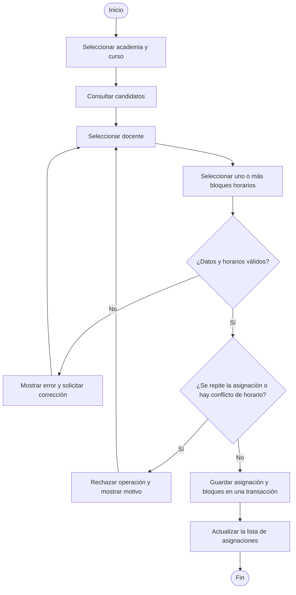
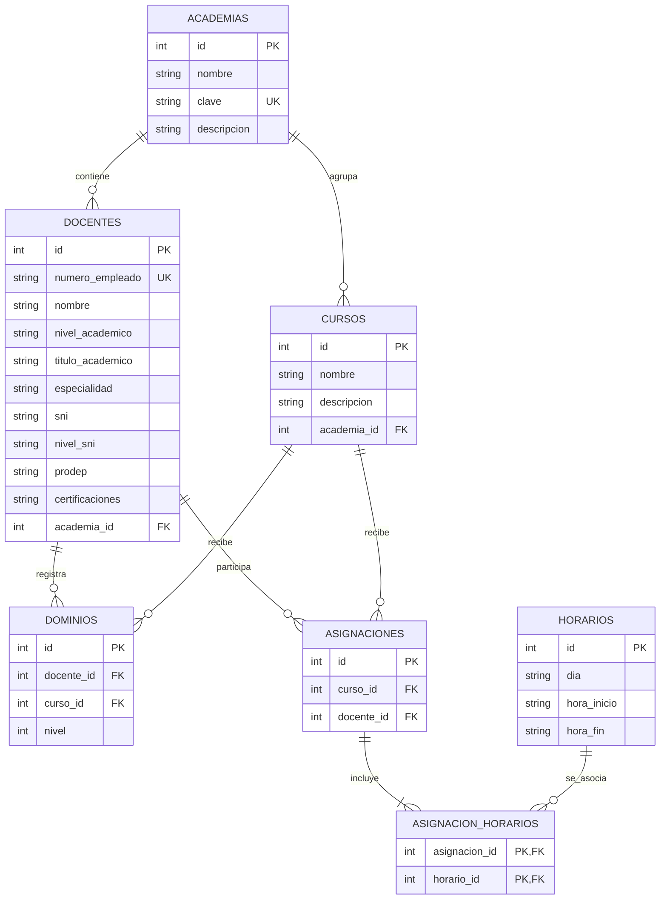

# Levantamiento de Requerimientos de Software

## Sistema de Gestión de Información Académica de Docentes

---

## 1. Propósito del documento

Este documento describe el alcance, las funciones, las reglas de negocio, los datos y las restricciones de la versión actual del Sistema de Gestión de Información Académica de Docentes. Su objetivo es establecer una referencia verificable para el desarrollo, las pruebas y la presentación del proyecto.

## 2. Descripción general

El sistema es una aplicación web local para registrar y consultar información básica de docentes, academias y cursos. También permite registrar el nivel de dominio de un docente sobre un curso y crear asignaciones manuales de docentes a cursos con bloques de horario predefinidos.

La aplicación ayuda al administrador a consultar la información registrada y a revisar candidatos para un curso. **No ejecuta un algoritmo completo de elegibilidad basado en competencias y certificaciones ni asigna docentes automáticamente.** La selección final corresponde al administrador.

La versión actual se concentra en cinco módulos operativos: academias, docentes, cursos, dominios y asignaciones. Incluye, además, catálogos de apoyo y una lista fija de bloques horarios.

## 3. Alcance del prototipo

### 3.1 Funciones incluidas

- Registrar, consultar, actualizar y eliminar academias, sujeto a las restricciones de integridad.
- Registrar, consultar, actualizar y eliminar docentes, sujeto a las restricciones de integridad.
- Registrar, consultar, actualizar y eliminar cursos, sujeto a las restricciones de integridad.
- Registrar, consultar, actualizar y eliminar el nivel de dominio de un docente sobre un curso.
- Consultar los catálogos de grados académicos, niveles SNI y especialidades utilizados por los formularios.
- Consultar los bloques horarios disponibles.
- Crear y consultar asignaciones manuales de docentes a cursos.
- Asociar uno o varios bloques horarios a cada asignación.
- Eliminar asignaciones y permitir que los bloques asociados se liberen.
- Validar en el servidor las reglas principales de integridad antes de guardar cambios.
- Persistir la información en una base de datos SQLite local.

### 3.2 Funciones fuera del alcance de esta versión

Las siguientes funciones pertenecen al diseño conceptual o a posibles ampliaciones. No deben presentarse como implementadas en el prototipo actual:

- Autenticación, cuentas de usuario, sesiones, roles y permisos.
- Elegibilidad automática mediante competencias, requisitos de cursos o certificaciones vigentes.
- Administración de competencias y requisitos obligatorios o recomendados.
- Registro separado de múltiples grados académicos y certificaciones con fechas de vigencia por docente.
- Pertenencia de un docente a varias academias.
- Asociación de un curso con varias academias.
- Secuencias académicas y relaciones de precedencia entre cursos.
- Gestión de proyectos académicos y de docentes responsables o participantes.
- Registro de aulas, laboratorios, recursos y equipamiento.
- Reservación de espacios físicos.
- Gestión de estudiantes, periodos escolares, nómina o recursos humanos.
- Notificaciones, reportes estadísticos avanzados e integración con sistemas externos.
- Auditoría histórica de cambios y desactivación lógica generalizada de registros.

## 4. Usuarios y entorno operativo

### 4.1 Usuario previsto

| Usuario | Funciones | Estado |
|---|---|---|
| Administrador operativo | Gestionar academias, docentes, cursos, dominios y asignaciones | Único perfil previsto para el prototipo; no se implementa inicio de sesión |

El sistema no verifica la identidad de quien lo utiliza. La ausencia de autenticación limita su uso previsto a un entorno académico controlado y de demostración; no implica que el servidor deba exponerse a una red pública.

### 4.2 Entorno técnico

| Componente | Tecnología |
|---|---|
| Interfaz | HTML, CSS, JavaScript y W3.CSS |
| Servidor | Node.js y Express |
| Acceso a datos | `better-sqlite3` mediante un DAO y modelos separados |
| Base de datos | SQLite, archivo `db/app.db` |
| Comunicación | Solicitudes HTTP desde la interfaz a la API local |
| Ejecución habitual | API en `http://localhost:3000` e interfaz servida por separado durante el desarrollo |

## 5. Requerimientos funcionales

Los siguientes requerimientos describen la versión actual. La prioridad indica su importancia dentro del prototipo, no una promesa de disponibilidad fuera de su alcance.

### 5.1 Gestión de academias

#### RF-ACA-01 — Consultar academias
El sistema deberá permitir consultar las academias registradas y sus datos principales.

**Prioridad:** Alta.  
**Criterio de aceptación:** la consulta devuelve los registros existentes sin modificar la base de datos.

#### RF-ACA-02 — Registrar academia
El sistema deberá permitir registrar una academia con nombre, clave y descripción.

**Prioridad:** Alta.  
**Criterios de aceptación:**
- El nombre y la clave son obligatorios.
- La clave contiene únicamente letras ASCII sin acentos y números, no contiene espacios y tiene entre 1 y 10 caracteres.
- La clave no puede duplicarse, sin distinguir entre mayúsculas y minúsculas.
- Una solicitud inválida se rechaza con un mensaje comprensible.

#### RF-ACA-03 — Actualizar academia
El sistema deberá permitir modificar los datos de una academia existente y conservar su identificador.

**Prioridad:** Alta.  
**Criterio de aceptación:** el sistema rechaza una clave duplicada y no modifica la academia si la validación falla.

#### RF-ACA-04 — Eliminar academia
El sistema deberá permitir eliminar una academia únicamente cuando no tenga docentes ni cursos asociados.

**Prioridad:** Media.  
**Criterio de aceptación:** si existen dependencias, la operación se rechaza y se informa el motivo.

### 5.2 Gestión de docentes

#### RF-DOC-01 — Consultar docentes
El sistema deberá mostrar los docentes registrados y sus principales datos académicos y administrativos.

**Prioridad:** Alta.

#### RF-DOC-02 — Registrar docente
El sistema deberá permitir registrar un docente mediante número de empleado, nombre, nivel y título académico, especialidad, información SNI, perfil PRODEP, certificaciones y academia.

**Prioridad:** Alta.  
**Criterios de aceptación:**
- Número de empleado, nombre, nivel académico, título académico y academia son obligatorios.
- El número de empleado no se puede duplicar.
- El nivel académico debe corresponder a una opción reconocida por el sistema.
- Si el docente pertenece al SNI, debe especificarse su nivel.
- La academia indicada debe existir.

#### RF-DOC-03 — Actualizar docente
El sistema deberá permitir modificar la información de un docente existente.

**Prioridad:** Alta.  
**Criterios de aceptación:** se conservan las reglas de validación del registro y no se permite duplicar el número de empleado.

#### RF-DOC-04 — Eliminar docente
El sistema deberá permitir eliminar un docente cuando no existan dominios o asignaciones que dependan de él.

**Prioridad:** Media.  
**Criterio de aceptación:** si existen relaciones dependientes, la eliminación se rechaza y la información permanece intacta.

### 5.3 Gestión de cursos

#### RF-CUR-01 — Consultar cursos
El sistema deberá mostrar los cursos registrados, su descripción y la academia a la que pertenecen.

**Prioridad:** Alta.

#### RF-CUR-02 — Registrar curso
El sistema deberá permitir registrar un curso mediante nombre, descripción y academia.

**Prioridad:** Alta.  
**Criterios de aceptación:** el nombre y la academia son obligatorios; la academia debe existir; no se permite repetir el mismo nombre dentro de una misma academia.

#### RF-CUR-03 — Actualizar curso
El sistema deberá permitir modificar la información de un curso existente.

**Prioridad:** Alta.  
**Criterios de aceptación:** se validan nuevamente el nombre y la academia; no se admiten duplicados dentro de la misma academia.

#### RF-CUR-04 — Eliminar curso
El sistema deberá permitir eliminar un curso cuando no existan dominios o asignaciones que dependan de él.

**Prioridad:** Media.  
**Criterio de aceptación:** si hay relaciones dependientes, la eliminación se rechaza.

### 5.4 Gestión de dominios

#### RF-DOM-01 — Consultar dominios
El sistema deberá mostrar los niveles de dominio registrados entre docentes y cursos.

**Prioridad:** Alta.

#### RF-DOM-02 — Registrar dominio
El sistema deberá permitir registrar el nivel de dominio de un docente sobre un curso.

**Prioridad:** Alta.  
**Criterios de aceptación:**
- El nivel es un número entero de 1 a 10.
- El docente y el curso deben existir.
- El docente y el curso deben pertenecer a la misma academia.
- Solo puede existir un registro para cada pareja docente-curso.

#### RF-DOM-03 — Actualizar dominio
El sistema deberá permitir cambiar el docente, el curso o el nivel de un registro de dominio, respetando las reglas de integridad.

**Prioridad:** Media.

#### RF-DOM-04 — Eliminar dominio
El sistema deberá permitir eliminar un registro de dominio existente.

**Prioridad:** Media.

### 5.5 Gestión de horarios y asignaciones

#### RF-ASI-01 — Consultar bloques horarios
El sistema deberá proporcionar los bloques horarios predefinidos disponibles para las asignaciones.

**Prioridad:** Alta.  
**Criterio de aceptación:** los bloques muestran día y hora de inicio y fin; no se administran desde la interfaz actual.

#### RF-ASI-02 — Consultar candidatos para asignación
El sistema deberá permitir consultar docentes candidatos para un curso y utilizar la información de academia y dominio registrada como apoyo para la decisión del administrador.

**Prioridad:** Alta.  
**Aclaración:** ordenar o mostrar candidatos no equivale a una evaluación automática completa de elegibilidad.

#### RF-ASI-03 — Registrar asignación
El sistema deberá permitir que el administrador asigne manualmente un docente a un curso y seleccione uno o varios bloques horarios.

**Prioridad:** Alta.  
**Criterios de aceptación:**
- El curso y el docente deben existir y pertenecer a la misma academia.
- La pareja curso-docente no puede asignarse más de una vez.
- Debe seleccionarse al menos un bloque horario válido.
- Un docente no puede tener el mismo bloque horario en dos asignaciones diferentes.
- Si la operación no cumple las reglas, no se registra parcialmente.

#### RF-ASI-04 — Consultar asignaciones
El sistema deberá mostrar las asignaciones registradas, sus cursos, docentes y bloques horarios asociados.

**Prioridad:** Alta.

#### RF-ASI-05 — Eliminar asignación
El sistema deberá permitir eliminar una asignación existente y retirar los vínculos con sus bloques horarios.

**Prioridad:** Media.

### 5.6 Catálogos

#### RF-CAT-01 — Consultar catálogos académicos
El sistema deberá permitir consultar los catálogos utilizados por los formularios: licenciaturas, maestrías, doctorados, niveles SNI y especialidades.

**Prioridad:** Media.  
**Restricción:** los catálogos se consultan; su administración desde la interfaz no forma parte de esta versión.

## 6. Reglas de negocio

| ID | Regla |
|---|---|
| RN-01 | La clave de academia es obligatoria, única y alfanumérica; su longitud máxima es de 10 caracteres y no admite espacios. |
| RN-02 | El número de empleado de un docente es único. |
| RN-03 | Cada docente registrado pertenece a una sola academia. |
| RN-04 | Cada curso registrado pertenece a una sola academia. |
| RN-05 | No puede repetirse el nombre de un curso dentro de la misma academia. |
| RN-06 | Un registro de dominio relaciona un único docente con un único curso. |
| RN-07 | El nivel de dominio es un entero entre 1 y 10; el valor 0 no se admite en la versión actual. |
| RN-08 | El docente y el curso de un dominio deben pertenecer a la misma academia. |
| RN-09 | Una asignación relaciona un curso y un docente; la misma pareja no se puede registrar más de una vez. |
| RN-10 | El curso y el docente asignados deben pertenecer a la misma academia. |
| RN-11 | Toda asignación debe tener al menos un bloque horario válido. |
| RN-12 | Un mismo docente no puede tener el mismo bloque horario en dos asignaciones distintas. |
| RN-13 | La restricción de horario se aplica al docente; dos docentes diferentes pueden utilizar el mismo bloque horario. |
| RN-14 | Una academia no se puede eliminar mientras tenga docentes o cursos asociados. |
| RN-15 | Un docente o curso no se puede eliminar mientras tenga relaciones de dominio o asignación que impidan la operación. |
| RN-16 | La asignación final es manual; el sistema no asigna docentes automáticamente. |
| RN-17 | La información se guarda en SQLite y debe persistir después de cerrar y reiniciar el servidor. |
| RN-18 | Las claves foráneas de SQLite deben permanecer activadas en la conexión de la aplicación. |

## 7. Requerimientos no funcionales

### RNF-01 — Integridad de datos
La aplicación deberá mantener las restricciones de unicidad y las relaciones entre entidades. Las reglas críticas se validarán en el servidor y, cuando corresponda, también mediante restricciones de SQLite.

### RNF-02 — Persistencia
Los cambios válidos deberán conservarse en `db/app.db` y permanecer disponibles después de reiniciar Node.js.

### RNF-03 — Seguridad frente a inyección SQL
Las consultas deberán utilizar sentencias preparadas y parámetros para los valores recibidos. Los nombres dinámicos de tablas o columnas, si existen, deberán controlarse mediante listas permitidas; no se deben construir consultas concatenando entradas del usuario.

### RNF-04 — Validación de entradas
El servidor no deberá depender exclusivamente de las validaciones del navegador. Deberá validar campos obligatorios, formatos, identificadores, rangos numéricos y relaciones entre entidades antes de persistir los cambios.

### RNF-05 — Manejo de errores
Las respuestas HTTP deberán comunicar los errores de forma comprensible sin exponer al cliente trazas, rutas internas o detalles de SQLite. Los detalles técnicos se podrán registrar en la consola del servidor durante el desarrollo.

### RNF-06 — Mantenibilidad
La solución deberá mantener separadas la interfaz, las rutas HTTP, los modelos de datos y la capa de acceso a SQLite, siguiendo la estructura actual del proyecto.

### RNF-07 — Usabilidad
Los formularios deberán identificar los campos obligatorios y mostrar mensajes claros cuando una operación sea rechazada.

### RNF-08 — Uso previsto y exposición de red
La versión actual no cuenta con autenticación ni autorización. Por tanto, deberá utilizarse en un entorno local o controlado y no se considerará lista para exposición pública hasta añadir los controles de acceso y la configuración de red apropiados.

### RNF-09 — Respaldo
Antes de cambios importantes o demostraciones relevantes, se recomienda realizar una copia de `db/app.db`. Para copiarla de forma simple, se debe detener primero el servidor.

### RNF-10 — Rendimiento
No se ha establecido un objetivo de rendimiento formal ni se ha realizado una prueba de carga. El rendimiento se evaluará según el uso esperado del prototipo académico.

## 8. Modelo de datos lógico actual

La base de datos actual utiliza SQLite. Los nombres físicos de las columnas se mantienen en `snake_case`, mientras que la API puede presentar propiedades en `camelCase`.

| Entidad/tabla | Propósito y restricciones relevantes |
|---|---|
| `academias` | Guarda nombre, clave y descripción. La clave debe ser única. |
| `docentes` | Guarda número de empleado, nombre, nivel y título académico, especialidad, indicadores SNI y PRODEP, certificaciones y referencia a una academia. El número de empleado es único. |
| `cursos` | Guarda nombre, descripción y academia. El nombre es único dentro de cada academia. |
| `dominios` | Relaciona docente y curso y almacena un nivel de 1 a 10. La pareja docente-curso es única. |
| `asignaciones` | Relaciona un docente con un curso. La pareja curso-docente es única. |
| `horarios` | Contiene los bloques de horario predefinidos. |
| `asignacion_horarios` | Tabla asociativa que vincula una asignación con uno o varios bloques horarios. |
| `licenciaturas` | Catálogo de licenciaturas. |
| `maestrias` | Catálogo de maestrías. |
| `doctorados` | Catálogo de doctorados. |
| `niveles_sni` | Catálogo de niveles SNI. |
| `especialidades` | Catálogo de especialidades. |

### 8.1 Relaciones principales

- Una academia puede tener varios docentes; cada docente pertenece a una academia.
- Una academia puede tener varios cursos; cada curso pertenece a una academia.
- Un docente y un curso pueden relacionarse mediante un registro de dominio.
- Un docente y un curso pueden relacionarse mediante una asignación, con un máximo de una asignación para esa pareja.
- Una asignación tiene uno o varios bloques horarios mediante `asignacion_horarios`.
- Un docente puede tener múltiples asignaciones, siempre que no repita un bloque horario entre ellas.
- Los catálogos alimentan los formularios y no son entidades administrables desde la interfaz actual.

### 8.2 Decisiones de modelado que difieren del diseño original

| Diseño original | Implementación actual |
|---|---|
| Un docente puede pertenecer a varias academias | Cada docente tiene una sola `academia_id` |
| Un curso puede pertenecer a varias academias | Cada curso tiene una sola `academia_id` |
| El dominio admite valores de 0 a 10 | Se admite de 1 a 10; el valor 0 está excluido |
| Curso con clave propia y requisitos de competencias | El curso actual se identifica mediante su ID; la unicidad de negocio es el nombre dentro de la academia |
| Certificaciones y grados como registros relacionados con fecha y vigencia | Se guardan campos de formulario y catálogos; no hay gestión completa de vigencias ni de múltiples registros por docente |
| Elegibilidad automática según requisitos y certificaciones | La aplicación presenta información de apoyo; la decisión se mantiene manual |
| Gestión de secuencias, proyectos, espacios y recursos | No implementada en esta versión |
| Desactivación lógica de todas las entidades | Algunas eliminaciones físicas se permiten si no existen relaciones que las bloqueen |

## 9. Casos de uso principales

### CU-01 — Registrar una academia

**Actor:** Administrador operativo.  
**Precondición:** el servidor y la base de datos están disponibles.

**Flujo principal:**
1. El administrador abre el módulo de academias.
2. Captura nombre, clave y descripción.
3. La interfaz verifica los campos del formulario.
4. El servidor vuelve a validar los datos.
5. El modelo comprueba la unicidad y registra la academia.
6. La interfaz actualiza la información mostrada.

**Alternativas y errores:** clave inválida, campos obligatorios vacíos o clave duplicada. El sistema rechaza la operación e informa el motivo.

### CU-02 — Registrar un docente

**Actor:** Administrador operativo.  
**Precondición:** existe al menos una academia.

**Flujo principal:**
1. El administrador abre el módulo de docentes.
2. Captura los datos obligatorios y selecciona una academia.
3. Si indica pertenencia al SNI, selecciona el nivel correspondiente.
4. El servidor valida los campos, el nivel académico, la unicidad del número de empleado y la existencia de la academia.
5. El sistema registra el docente y muestra el resultado.

**Alternativas y errores:** número de empleado duplicado, academia inexistente o información obligatoria faltante.

### CU-03 — Registrar el dominio de un docente sobre un curso

**Actor:** Administrador operativo.  
**Precondición:** existe el docente y el curso.

**Flujo principal:**
1. El administrador abre el módulo de dominios.
2. Selecciona docente y curso.
3. Captura un nivel entero entre 1 y 10.
4. El servidor verifica existencia, academia compartida y ausencia de una pareja duplicada.
5. El sistema registra el dominio.

**Alternativas y errores:** nivel fuera de rango, entidades inexistentes, academias distintas o pareja ya registrada.

### CU-04 — Registrar una asignación

**Actor:** Administrador operativo.  
**Precondición:** existe un curso y al menos un docente elegible para el proceso administrativo de selección; ambos deben pertenecer a la misma academia.

**Flujo principal:**
1. El administrador selecciona la academia y el curso.
2. Consulta los docentes disponibles para esa selección y la información de dominio.
3. Selecciona manualmente un docente.
4. Añade uno o varios bloques horarios.
5. El servidor comprueba existencia de entidades, coincidencia de academia, duplicidad de asignación, validez de bloques y conflictos de horario del docente.
6. El sistema registra la asignación y sus bloques en una operación transaccional.
7. La interfaz muestra la asignación registrada.

**Alternativas y errores:** no se seleccionó horario, se repite la pareja curso-docente, hay academias diferentes o el docente ya ocupa uno de los bloques elegidos. La operación se rechaza sin dejar una asignación incompleta.

### CU-05 — Eliminar un registro con relaciones

**Actor:** Administrador operativo.  
**Precondición:** existe el registro seleccionado.

**Flujo principal:**
1. El administrador solicita eliminar una academia, docente o curso.
2. El sistema verifica si hay entidades dependientes.
3. Si la eliminación está permitida, se elimina el registro.
4. Si existen relaciones bloqueantes, el servidor rechaza la solicitud y explica que primero deben resolverse las dependencias.

## 10. Matriz de trazabilidad resumida

| Regla | Requerimientos relacionados | Casos de uso |
|---|---|---|
| RN-01 | RF-ACA-02, RF-ACA-03 | CU-01 |
| RN-02 | RF-DOC-02, RF-DOC-03 | CU-02 |
| RN-03, RN-04 | RF-DOC-02, RF-CUR-02, RF-DOM-02, RF-ASI-03 | CU-02, CU-03, CU-04 |
| RN-05 | RF-CUR-02, RF-CUR-03 | — |
| RN-06, RN-07, RN-08 | RF-DOM-02, RF-DOM-03 | CU-03 |
| RN-09, RN-10 | RF-ASI-03 | CU-04 |
| RN-11, RN-12, RN-13 | RF-ASI-01, RF-ASI-03, RF-ASI-04 | CU-04 |
| RN-14, RN-15 | RF-ACA-04, RF-DOC-04, RF-CUR-04 | CU-05 |
| RN-17, RN-18 | RF-ACA-01, RF-DOC-01, RF-CUR-01, RF-DOM-01, RF-ASI-04 | Todos los casos de uso con persistencia |

## 11. Diagramas Mermaid

### 11.1 Flujo general para registrar una asignación

### 11.2 Diagrama entidad-relación simplificado

## 12. Pruebas de aceptación mínimas

| ID | Prueba | Resultado esperado |
|---|---|---|
| PA-01 | Crear una academia con clave válida | Se registra y aparece en la consulta |
| PA-02 | Crear una academia con espacios en la clave | Se rechaza y se informa que no se permiten espacios |
| PA-03 | Registrar una clave de academia duplicada, ignorando mayúsculas | Se rechaza sin crear un registro adicional |
| PA-04 | Registrar dos docentes con el mismo número de empleado | El segundo registro se rechaza |
| PA-05 | Registrar un docente con SNI = sí y sin nivel SNI | El registro se rechaza |
| PA-06 | Crear dos cursos con el mismo nombre en una academia | El segundo se rechaza |
| PA-07 | Crear el mismo nombre de curso en academias distintas | Se permite, porque la unicidad del nombre se aplica dentro de cada academia |
| PA-08 | Registrar un dominio con nivel 0, 11 o decimal | Se rechaza |
| PA-09 | Registrar un dominio entre docente y curso de academias distintas | Se rechaza |
| PA-10 | Registrar una asignación sin bloque horario | Se rechaza |
| PA-11 | Asignar a un docente un bloque ya utilizado en otra asignación | Se rechaza |
| PA-12 | Asignar el mismo bloque horario a docentes distintos | Se permite si se cumplen las demás reglas |
| PA-13 | Eliminar una academia que tenga docentes o cursos asociados | Se rechaza y los datos permanecen intactos |
| PA-14 | Reiniciar el servidor después de crear un registro válido | El registro persiste en SQLite |
| PA-15 | Enviar una cadena típica de inyección SQL como dato de texto | Se trata como dato, no como parte ejecutable de la consulta |

## 13. Ampliaciones futuras

Las ideas siguientes pueden retomarse en versiones posteriores, pero requieren nuevos requerimientos, diseño de datos, implementación y pruebas antes de considerarse disponibles:

1. Evaluación automática de elegibilidad con requisitos obligatorios y recomendados.
2. Gestión normalizada de grados académicos, certificaciones, competencias y sus vigencias.
3. Relación de docentes y cursos con múltiples academias.
4. Secuencias académicas y precedencia de cursos.
5. Proyectos académicos con responsables, participantes, recursos y espacios asociados.
6. Gestión de aulas y laboratorios con inventario y capacidad.
7. Gestión de recursos, cantidades disponibles y necesidades por proyecto.
8. Autenticación, autorización y controles de acceso.
9. Historial de cambios, auditoría y desactivación lógica de registros.
10. Gestión de periodos escolares, estudiantes, reportes e integraciones externas.

## 14. Decisiones finales del alcance actual

- La versión actual es un prototipo RAD centrado en datos de docentes, academias, cursos, dominios y asignaciones.
- La interfaz permite al administrador operar los módulos sin iniciar sesión.
- Los docentes y los cursos pertenecen a una única academia en esta versión.
- El dominio se registra manualmente en una escala de 1 a 10.
- La asignación de docentes es manual; no hay un motor completo de elegibilidad automática.
- Los horarios son bloques fijos asociados a las asignaciones, no un sistema de reservación de aulas.
- Los datos persisten en `db/app.db`.
- El diseño futuro puede ampliar el modelo, pero esas ampliaciones no deben confundirse con las capacidades actuales.